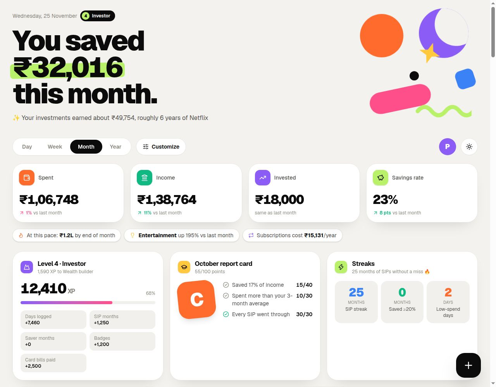
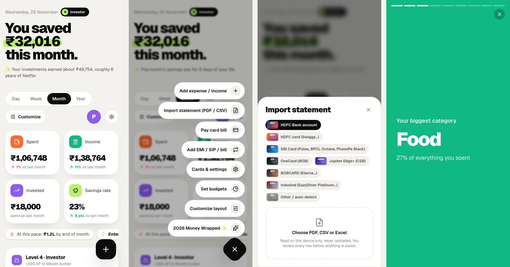
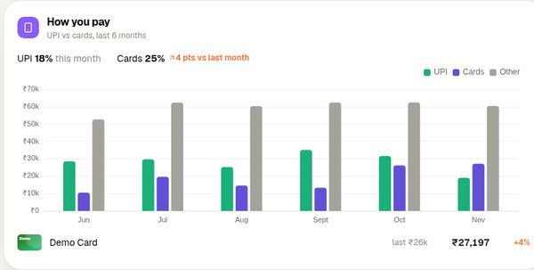

# ₹ Paisa Tracker

A playful, private personal-finance dashboard. Track spending, income, credit cards, mutual funds,
stocks, FDs/RDs and loans. Import bank and card statements, and stay motivated with streaks,
badges and a "freedom meter". Works on any device and installs on iPhone like an app.

**Live:** https://paisa-tracker-app.vercel.app · **Cost:** ₹0 (Supabase free tier + Vercel Hobby)

## Using it

- **＋** (bottom right): add expense/income, stock/FD/RD investment, import a statement, pay a card bill, add EMI/SIP/FD/RD/bill, cards & settings, customize layout.
- **Tap anything** you added to edit or delete it. **Customize** reorders or hides cards.
- First time: 👤 → **Cards & settings** → add your credit cards (limit and due day are optional).








<sub>All screenshots use generated demo data. A full illustrated feature guide is in [docs/features.html](docs/features.html) (open it in a browser).</sub>

<sub>Review follow-up: [what changed and what needs a separate decision](docs/review-findings.html).</sub>

## What it does

| Area | Features |
|---|---|
| **Track** | Expenses, income (including Flexipay), investments with category, mode, note · search, edit, delete · custom categories and payment modes · one **＋** menu for every action |
| **Recurring** | Loans/EMIs (principal, rate, tenure, calculated EMI and total repayment), SIPs, FDs/RDs, subscriptions, bills, rent, salary · **Coming up** list with *Mark paid* · edits apply "from now on" or "past + future" |
| **Import** | HDFC Bank; HDFC, SBI (Pulse, BPCL Octane, PhonePe Black), OneCard, BOBCARD, IndusInd and Jupiter cards; any CSV/Excel/PDF · password PDFs · read on the device only · review every row · balance reconciliation (opening + credits − debits = closing) · refunds reduce spending · ambiguous rows need review · bill payments saved as transfers |
| **Payments** | UPI vs cards vs other, month by month · each card this month vs last · "Where it went" shows spending by purchase date (including card swipes) and investments |
| **Budgets** | Monthly limit per category with rings, "ahead of pace" and over-budget alerts |
| **Cards, deeper** | Statement and due days · spend on this bill · estimated rewards · "best card for this spend" hint that applies saved caps, minimum spend, eligible-spend limits and exclusions |
| **Credit score** | Log CIBIL/Experian scores, trend, band and tips (uses your card utilisation) |
| **Split bills** | Split with friends equally; only your share is spending; "Friends owe you" with one-tap settle |
| **Reminders** | Add every EMI, SIP, bill and card due date to your phone calendar (alert the evening before) |
| **Year in review** | "Money Wrapped" story slides, shareable |
| **Export** | Everything to Excel; print or save the dashboard as PDF |
| **Credit cards** | Purchases count in the month swiped; a later bill payment is a transfer and is not counted as spending again · card dues, limit use, cycles and due dates · *Pay bill* · bank balance and net worth account for dues |
| **Salary month** | Salary arriving on/after a cut-off day (default 25th) counts for the next month |
| **Investments** | Link SIPs to real funds by name · units from that day's NAV · current value, gain, last-day change, invested-vs-value trend · existing holdings (units + total or average price) · NSE/BSE stock lots with buy date, units, price, P&L and XIRR |
| **FDs, RDs & loans** | One-time and recurring deposits with rate, term, compounding, payout and maturity details · maturity estimate or receipt value · calculate loan EMI, total repayment and interest |
| **Stocks** | TejHQ daily end-of-day NSE/BSE chart and saved quote, refreshed on first view and about once a day while the page is open · manual refresh · not intraday or broker-connected · XIRR is annualized and hidden when the holding period is zero |
| **See it** | Day/Week/Month/Year, compared with the same point last period · spending pace, category donut, money-flow sankey, income vs spend, spending calendar, top merchants, net worth, bank balance. Card-bill transfers are excluded from Money Flow to avoid double counting; they appear in "Where it went" and bank cash flow. |
| **Stay motivated** | Level & XP, monthly report card, streaks, 12 badges (incl. card limits, bill payer, portfolio), challenges, goals, freedom (FIRE) meter, milestone celebrations, "higher or lower?" quiz (spending, UPI vs card, your cards, your funds) |
| **Yours** | Email/password login, every row private per user · light/dark · **Customize** card order and visibility (hidden cards move to the bottom of the list) · cards & settings · installable PWA |

Stock data is currently for the owner's personal dashboard. The provider's terms require a paid plan for apps that show data to other users, and exchange terms may also apply. Confirm permitted use before making this feature available to other people; do not enable a paid plan without approval.

## Install on iPhone

Open the live link in **Safari** → Share → **Add to Home Screen** → sign in once inside the app.

## Develop

```bash
npm install
npm run dev        # http://localhost:3000   (/preview = demo dashboard, no login)
npm run check      # types + lint + logic self-test
npm run deploy     # check, then deploy to Vercel (run `npm run db:push` first if migrations changed)
```

On a new laptop: `npm install`, `npx vercel login`, `npx vercel link --project finance-dash`, `npx vercel env pull .env.local`.
Needs a `.env.local` with `NEXT_PUBLIC_SUPABASE_URL` and `NEXT_PUBLIC_SUPABASE_ANON_KEY`
(local Supabase via Docker, or the hosted project). Full setup, deploy steps and the rules the
code relies on are in **[AGENTS.md](AGENTS.md)**.

## Stack

Next.js 16 (client-rendered) · Tailwind CSS 4 · Motion · Apache ECharts · Supabase (Postgres, Auth, Row-Level Security) ·
Vercel · pdf.js + SheetJS for statements · MF NAVs from AMFI via [mfapi.in](https://www.mfapi.in).

## Privacy

- Each account sees only its own rows (database-enforced Row-Level Security).
- Statements are parsed in your browser; only the rows you approve are saved.
- No analytics, no ads, no third-party trackers.
