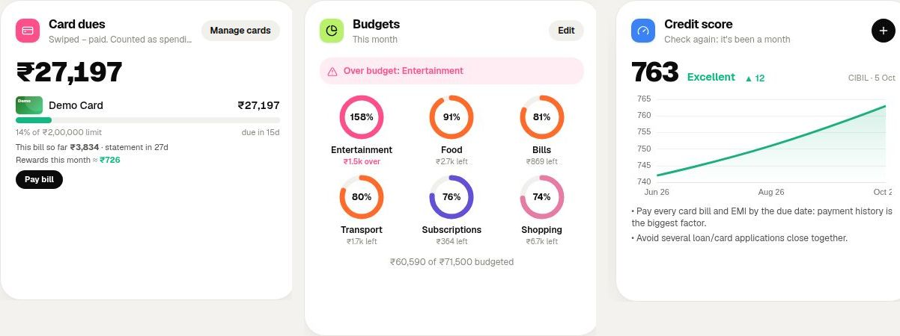

# ₹ Paisa Tracker

A playful, private personal-finance dashboard. Log spending, EMIs, SIPs and subscriptions,
watch your mutual funds at live NAVs, import bank and card statements, and stay motivated
with streaks, badges and a "freedom meter". Works on any device and installs on iPhone like an app.

**Live:** https://paisa-tracker-app.vercel.app · **Cost:** ₹0 (Supabase free tier + Vercel Hobby)

## Using it

- **＋** (bottom right): add expense/income, import a statement, pay a card bill, add EMI/SIP/bill, cards & settings, customize layout.
- **Tap anything** you added to edit or delete it. **Customize** reorders or hides cards.
- First time: 👤 → **Cards & settings** → add your credit cards (limit and due day are optional).





<sub>All screenshots use generated demo data. A full illustrated feature guide is in [docs/features.html](docs/features.html) (open it in a browser).</sub>

## What it does

| Area | Features |
|---|---|
| **Track** | Expenses, income, investments with category, mode, note · search, edit, delete · custom categories and payment modes · one **＋** menu for every action |
| **Recurring** | EMIs (tenure, progress, end date), SIPs, subscriptions (monthly/yearly), bills, rent, salary · **Coming up** list with *Mark paid* · edits apply "from now on" or "past + future" |
| **Import** | HDFC Bank; HDFC, SBI (Pulse, BPCL Octane, PhonePe Black), OneCard, BOBCARD, IndusInd and Jupiter cards; any CSV/Excel/PDF · password PDFs · read on the device only · review every row · balance reconciliation (opening + credits − debits = closing) · duplicates and refunds flagged · bill payments saved as transfers |
| **Payments** | UPI vs cards vs other, month by month · each card this month vs last |
| **Budgets** | Monthly limit per category with rings, "ahead of pace" and over-budget alerts |
| **Cards, deeper** | Billing cycle (spend on this bill, days to statement) · rewards earned · "best card for this spend" hint |
| **Credit score** | Log CIBIL/Experian scores, trend, band and tips (uses your card utilisation) |
| **Split bills** | Split with friends equally; only your share is spending; "Friends owe you" with one-tap settle |
| **Reminders** | Add every EMI, SIP, bill and card due date to your phone calendar (alert the evening before) |
| **Year in review** | "Money Wrapped" story slides, shareable |
| **Export** | Everything to Excel; print or save the dashboard as PDF |
| **Credit cards** | Spends count when swiped; the bill payment moves money bank → card (not spending) · card dues per card with limit use and due dates · *Pay bill* · bank balance and net worth account for dues |
| **Salary month** | Salary arriving on/after a cut-off day (default 25th) counts for the next month |
| **Investments** | Link SIPs to real funds by name · units from that day's NAV · current value, gain, last-day change, invested-vs-value trend · existing holdings (units + total or average price) |
| **See it** | Day/Week/Month/Year, compared with the same point last period · spending pace, category donut, money-flow sankey, income vs spend, spending calendar, top merchants, net worth, bank balance |
| **Stay motivated** | Level & XP, monthly report card, streaks, 12 badges (incl. card limits, bill payer, portfolio), challenges, goals, freedom (FIRE) meter, milestone celebrations, "higher or lower?" quiz (spending, UPI vs card, your cards, your funds) |
| **Yours** | Email/password login, every row private per user · light/dark · **Customize** card order and visibility (synced) · cards & settings · installable PWA |

## Install on iPhone

Open the live link in **Safari** → Share → **Add to Home Screen** → sign in once inside the app.

## Develop

```bash
npm install
npm run dev        # http://localhost:3000   (/preview = demo dashboard, no login)
npm run check      # types + lint + logic self-test
npm run deploy     # check, then deploy to Vercel (run `npm run db:push` first if migrations changed)
```

On a new laptop: `npm install`, `npx vercel login`, `npx vercel link --project finance-dash`, `npx vercel env pull .env.local`.
Needs a `.env.local` with `NEXT_PUBLIC_SUPABASE_URL` and `NEXT_PUBLIC_SUPABASE_ANON_KEY`
(local Supabase via Docker, or the hosted project). Full setup, deploy steps and the rules the
code relies on are in **[AGENTS.md](AGENTS.md)**.

## Stack

Next.js 16 (client-rendered) · Tailwind CSS 4 · Motion · Apache ECharts · Supabase (Postgres, Auth, Row-Level Security) ·
Vercel · pdf.js + SheetJS for statements · MF NAVs from AMFI via [mfapi.in](https://www.mfapi.in).

## Privacy

- Each account sees only its own rows (database-enforced Row-Level Security).
- Statements are parsed in your browser; only the rows you approve are saved.
- No analytics, no ads, no third-party trackers.
